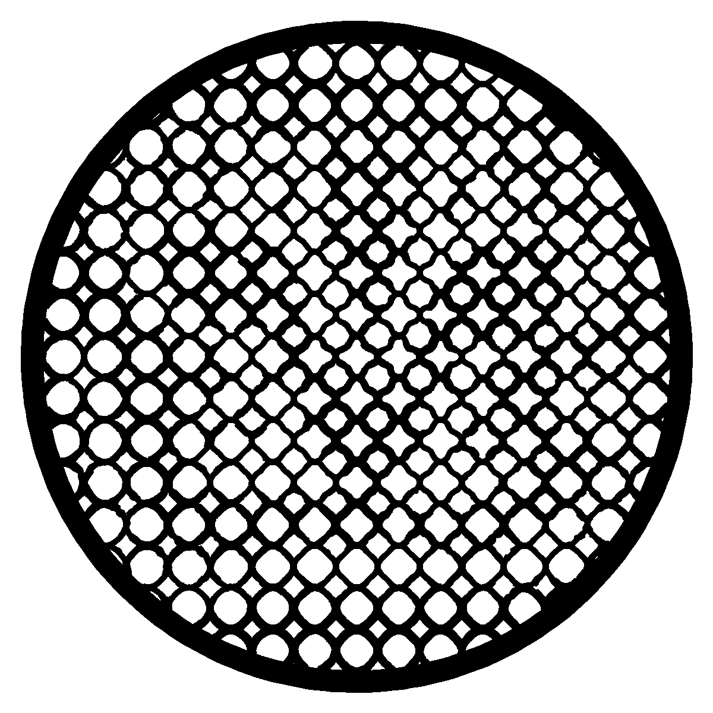
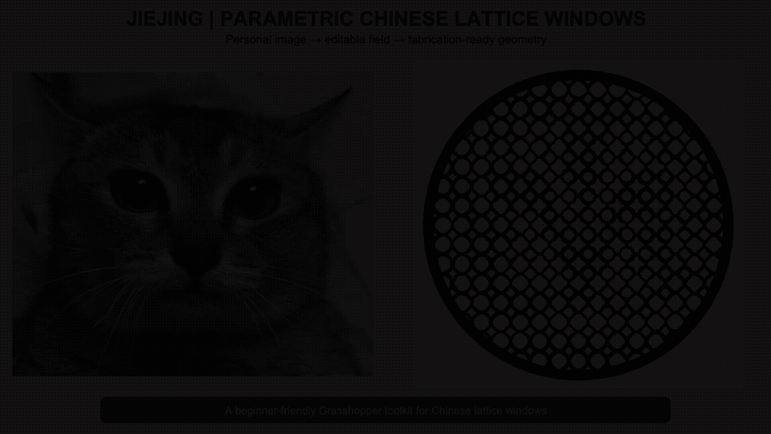

# JIEJING | 借景

**A beginner-friendly Grasshopper toolkit for designing fabrication-ready Chinese lattice windows.**

JIEJING combines curated lattice recipes, parametric controls, borrowed-view openings,
and optional image-driven fields. A user can begin with a window size and a photograph,
then export 1:1 DXF, SVG, and PDF geometry for laser-cutting workflows—without AI image
generation or a local machine-learning model.

| Input image | Material preview |
|---|---|
|  |  |

## What it does

- Generates 14 curated and parametric lattice recipes.
- Validates a closed planar Rhino window boundary.
- Adjusts density, lattice weight, and frame weight.
- Adds optional borrowed-view openings using ellipse, circle, hexagon, octagon,
  clipped rectangle, begonia, plum, ruyi, fan, or gourd profiles.
- Converts a JPG or PNG into a non-AI image field with silhouette, portrait-detail,
  and hybrid modes.
- Produces a black-and-white material preview.
- Exports fabrication curves as 1:1 DXF, SVG, and PDF.

## Fastest start

1. Download `JIEJING_Rhino8_v0.2.4.zip` from the latest GitHub Release.
2. Copy `JIEJING.Components.gha` into Grasshopper's Components/Libraries folder.
3. Restart Rhino 8 and open Grasshopper.
4. Open `starter/JIEJING_Baby_Starter.gh`.
5. Change the window sliders and select a lattice recipe.
6. Optional image workflow: right-click **IMAGE FILE** → **Select one existing file**,
   then choose a JPG or PNG.
7. Check the material preview before switching Export to `True`.

See [Installation](docs/INSTALL.md) for the complete setup.

## Components

The **JIEJING** Grasshopper tab contains:

- **Design:** Quick Generate, Window, Pattern, Borrowed View, Image Field
- **Make:** Compose, Material Preview, Export
- **Selectors:** Recipe, View Shape, Image Mode, Polarity

The Baby Starter is prewired for beginners. The Modular Starter exposes the reusable
workflow:

```text
Window + Pattern + Borrowed View + Image Field
                         ↓
                      Compose
                     ↙       ↘
          Material Preview   Export
```

## Image workflow

The image route is deterministic computer vision rather than generative AI. The plugin
reads tonal contrast and edges from the supplied image, maps them to a field, and changes
the scale/opening behavior of repeated lattice cells. Results depend on source contrast,
crop, recipe, density, polarity, and image strength.

The cat image in this repository is the common sample used throughout the documentation.

## Demonstration video



- [Watch or download the 77-second MP4](https://github.com/kaitongg-bit/JIEJING-Grasshopper/releases/download/v0.2.4/JIEJING_Demo_90s.mp4)
- [English subtitle file](docs/video/JIEJING_Demo_90s.srt)
- [Shot list and narration](docs/VIDEO_SCRIPT_90S.md)

## Requirements

- Rhino 8
- Grasshopper included with Rhino 8
- Internet access on first use if Rhino needs to install declared Python packages

## Project status

Version `0.2.4` is an academic release candidate developed for *Scripting and
Parametric Design*. It has been tested in Rhino 8 with the Baby Starter solving at
zero errors and zero warnings before an optional image is selected.

## Author

Kaitong Guan

